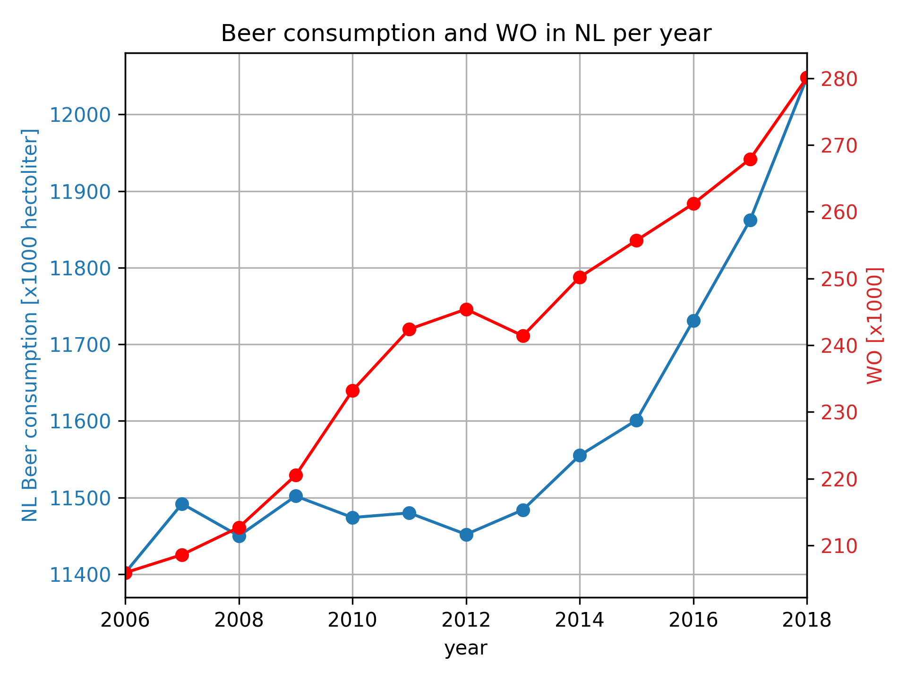

# Karel Nijhuis (12904392)

## Titles of papers pivotal to our knowledge:
- Fantastic yeasts and where to find them: the hidden diversity of dimorphic fungal pathogens 
- An analysis of the forces required to drag sheep over various surfaces
- The neurocognitive effects of alcohol on adolescents and college students 

## Correlation plot

From this image it can be observed that as WO increases, beer consumption in the Netherlands also increases. Although the two do not grow at the same rate, there is strong correlation between the datastes. More information is needed to establish a causal connection between the data.
